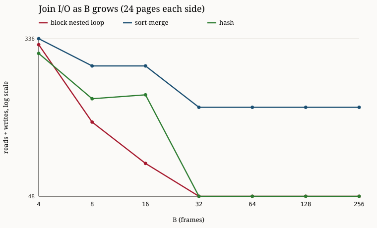
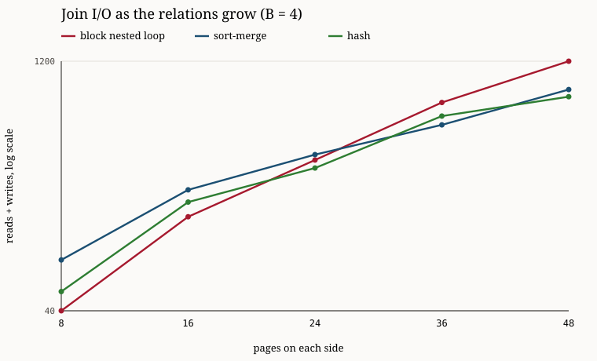
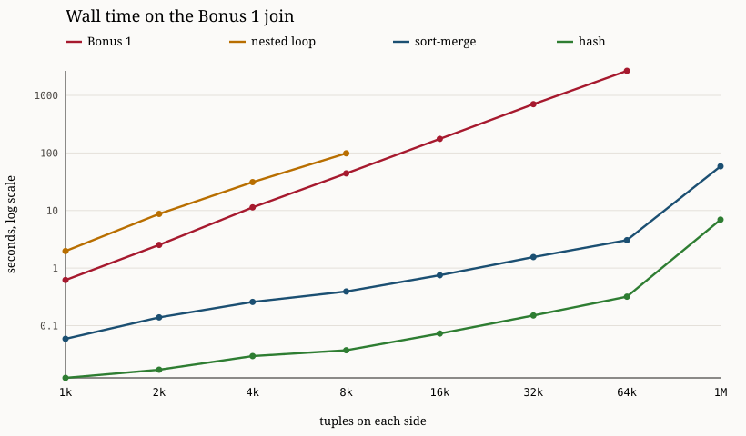

The numbers below come from `scripts/measure_m2.py`. It writes `data/m2_measurements.json` and the two plots. Both relations use `k INT, v VARCHAR(200)`. A record is 4 + 2 + 200 = 206 bytes, so a page holds floor(4088 / 210) = 19 tuples. I loaded full pages only, and the counters count data pages. Directory pages are not in them.

On every uniform input the three joins returned the same rows. The keys were `0 .. n-1` on both sides, so the output has one row per tuple. Where I rank the joins, the cost is page reads plus page writes. The vertical axis on both plots is logarithmic.

# Cost against the formula

`M` and `N` are the data pages of the two inputs. They are equal in every row unless stated otherwise.

Block nested loop, from section 2.7:

```
reads  = M + ceil(M / (B - 2)) * N
writes = 0
```

Sort-merge, from section 2.8. `sort(X)` is the section 2.5 sort: pass 0 reads and writes the input, a merge reads and writes only the runs it merges, a run that would be alone in its group is carried forward, and the last pass reads and does not write. The `M + N` is one more read of each sorted input during the merge. I split that into reads and writes.

Hash join, from section 2.9. Partitioning is one read and one write of each side, and probing is one more read:

```
reads  = 2(M + N)
writes = M + N
total  = 3(M + N)
```

| Join | Pages | B | Formula reads | Formula writes | Measured reads | Measured writes |
|------|------:|--:|--------------:|---------------:|---------------:|----------------:|
| nested loop | 8 | 4 | 40 | 0 | 40 | 0 |
| nested loop | 8 | 16 | 16 | 0 | 16 | 0 |
| nested loop | 8 | 64 | 16 | 0 | 16 | 0 |
| nested loop | 8 | 256 | 16 | 0 | 16 | 0 |
| nested loop | 24 | 4 | 312 | 0 | 312 | 0 |
| nested loop | 24 | 16 | 72 | 0 | 72 | 0 |
| nested loop | 24 | 64 | 48 | 0 | 48 | 0 |
| nested loop | 24 | 256 | 48 | 0 | 48 | 0 |
| nested loop | 48 | 4 | 1200 | 0 | 1200 | 0 |
| nested loop | 48 | 16 | 240 | 0 | 240 | 0 |
| nested loop | 48 | 64 | 96 | 0 | 96 | 0 |
| nested loop | 48 | 256 | 96 | 0 | 96 | 0 |
| sort-merge | 8 | 4 | 48 | 16 | 48 | 32 |
| sort-merge | 8 | 16 | 32 | 0 | 32 | 16 |
| sort-merge | 8 | 64 | 32 | 0 | 32 | 16 |
| sort-merge | 8 | 256 | 32 | 0 | 32 | 16 |
| sort-merge | 24 | 4 | 192 | 96 | 192 | 144 |
| sort-merge | 24 | 16 | 144 | 48 | 144 | 96 |
| sort-merge | 24 | 64 | 96 | 0 | 96 | 48 |
| sort-merge | 24 | 256 | 96 | 0 | 96 | 48 |
| sort-merge | 48 | 4 | 456 | 264 | 456 | 360 |
| sort-merge | 48 | 16 | 288 | 96 | 288 | 192 |
| sort-merge | 48 | 64 | 192 | 0 | 192 | 96 |
| sort-merge | 48 | 256 | 192 | 0 | 192 | 96 |
| hash | 8 | 4 | 32 | 16 | 34 | 18 |
| hash | 8 | 16 | 32 | 16 | 16 | 0 |
| hash | 8 | 64 | 32 | 16 | 16 | 0 |
| hash | 8 | 256 | 32 | 16 | 16 | 0 |
| hash | 24 | 4 | 96 | 48 | 164 | 116 |
| hash | 24 | 16 | 96 | 48 | 108 | 60 |
| hash | 24 | 64 | 96 | 48 | 48 | 0 |
| hash | 24 | 256 | 96 | 48 | 48 | 0 |
| hash | 48 | 4 | 192 | 96 | 418 | 322 |
| hash | 48 | 16 | 192 | 96 | 208 | 112 |
| hash | 48 | 64 | 192 | 96 | 96 | 0 |
| hash | 48 | 256 | 192 | 96 | 96 | 0 |

Block nested loop matches the formula in every cell, and the writes are 0. The comparison count was `|R| × |S|` at every `B`: 23,104 at 8 pages (152 tuples a side), 207,936 at 24 pages (456 tuples), and 831,744 at 48 pages (912 tuples). It does not move when `B` does. The read count does. At `B = 4` a 48-page outer is taken 2 pages at a time, so the inner is scanned 24 times and the reads are 1,200. At `B = 64` and `B = 256`, `B - 2` is already larger than the outer, so each side is read once.

Sort-merge reads match the formula on every row. The writes are the formula writes plus `M + N`.

The formula's sort does not write its last pass. The join has to. The two sorts cannot be open together, because each one wants the whole budget, so I sort one side, write the finished run, sort the other side, and then merge. That is an extra `M + N` writes. When the input already fits in one run the formula writes are 0, and the measurement is those `M + N` writes.

An equal-key run stays in the free frames and is reread from there. These keys are unique, so each run is one tuple, it fits, and it adds no pages. A run that does not fit is written to a temporary file. None of these rows needed that.

For 8 pages at `B = 4` the formula is 48 reads and 16 writes. The measurement is 48 reads and 32 writes, and `32 − 16 = 16 = M + N`. For 48 pages at `B = 64` the formula is 192 reads and 0 writes. The measurement is 192 reads and 96 writes, and `96 = M + N`. Same pattern on the other rows.

If the build input is at most `B − 1` pages, hash join loads it and scans the probe side once. Reads are `M + N` and writes are 0, which is under the grace formula. At 8 pages that starts at `B = 16` (16 reads and 0 writes, against 32 and 16). At 24 pages it starts at `B = 32` (48 and 0, against 96 and 48). At 48 pages it starts at `B = 64`. Past that point a larger budget does not change the hash cost.

When the build side does not fit, the join opens `P = B − 1` partitions. Each one has its own last page, and an empty one is not written. The probe reads every page that was written, so with no second round the measured reads are `M + N` plus the measured writes.

At 8 pages and `B = 4` the three partitions were 3, 3 and 3 pages on each side, 18 writes against a formula of 16. The two extra pages are partial last pages. Reads were 34, which is the 16 scan pages plus those 18. No partition overflowed.

When a build partition was larger than `B - 1` it was partitioned again. At 24 pages and `B = 4` the first round was 9, 8 and 8 pages, all above 3, and every overflow step was another partition. The keys were unique, so the pieces shrank and none of them had to be joined with nested loop. Writes were 116 against 48, and reads were 164, which is 48 + 116. At 48 pages and `B = 4` the first round was 17, 17 and 16, there were twelve repartitions, and still no nested loop. Writes were 322 against 96, and reads were 418 = 96 + 322. At 48 pages and `B = 16` the largest partition was 4 pages, which fits in 15, so there was no second round and the gap shrinks to 16 extra writes.

# Sort passes

The formula is `1 + ceil(log(ceil(N / B)) / log(B - 1))`. One run is one pass. Every row below came out fully sorted, and `held` was 0 afterwards.

| N | B | ceil(N/B) | Formula | Measured | Reads | Writes | Peak frames |
|--:|--:|----------:|--------:|---------:|------:|-------:|------------:|
| 8 | 3 | 3 | 3 | 3 | 22 | 14 | 3 |
| 10 | 4 | 3 | 2 | 2 | 20 | 10 | 4 |
| 16 | 4 | 4 | 3 | 3 | 44 | 28 | 4 |
| 24 | 4 | 6 | 3 | 3 | 72 | 48 | 4 |
| 24 | 8 | 3 | 2 | 2 | 48 | 24 | 8 |
| 48 | 16 | 3 | 2 | 2 | 96 | 48 | 16 |
| 64 | 16 | 4 | 2 | 2 | 128 | 64 | 16 |
| 80 | 4 | 20 | 4 | 4 | 312 | 232 | 4 |

`N = 80` at `B = 4` is the `20 × B` case, and it is the run in the budget section. `N = 8` at `B = 3` is the worked example from section 2.5: three passes, 22 reads, 14 writes. Pass 1 merges two of the three runs and carries the third, which is why that pass is 6 and 6 rather than 8 and 8.

# Crossover

Both relations are 24 pages (456 tuples). Cost is reads plus writes.

| B | Nested loop | Hash | Sort-merge |
|--:|------------:|-----:|-----------:|
| 4 | 312 | 280 | 336 |
| 8 | 120 | 160 | 240 |
| 16 | 72 | 168 | 240 |
| 32 | 48 | 48 | 144 |
| 64 | 48 | 48 | 144 |
| 128 | 48 | 48 | 144 |
| 256 | 48 | 48 | 144 |



The ranking changes between `B = 4` and `B = 8`, and again at `B = 32`. At `B = 4` the outer block is 2 pages, the inner is scanned 12 times, and nested loop costs 312. Hash is 280 even after the second partition round. Sort-merge is 336, which is the formula's 288 plus the `M + N = 48` writes for the two finished runs. At `B = 8` the block is 6 pages, the inner is scanned 4 times, and nested loop drops to 120, under hash's 160. From `B = 32` upward, `B - 2` covers the outer relation and `B - 1` covers the build side, so nested loop and hash are each one scan of both sides and stay at 48. Sort-merge stays at 144, due to 96 reads from the formula, plus 48 writes for the two finished runs.

Then `B` is fixed at 4 and the relations grow together.

| Pages | Nested loop | Hash | Sort-merge |
|------:|------------:|-----:|-----------:|
| 8 | 40 | 52 | 80 |
| 16 | 144 | 176 | 208 |
| 24 | 312 | 280 | 336 |
| 36 | 684 | 568 | 504 |
| 48 | 1200 | 740 | 816 |



The ranking changes twice. At `B = 4` the nested loop cost is `M + ceil(M / 2) * M`, so it grows with the square of the page count: 40, 144, 312, 684, 1,200. Hash pays for a couple of sequential passes, including a repartition once a partition exceeds 3 pages: 52, 176, 280, 568, 740. It passes nested loop between 16 and 24 pages. Sort-merge is the two sorts plus one read and one write of each finished run: 80, 208, 336, 504, 816. That passes hash at 36 pages, where the hash repartition is still expensive, and hash passes it again at 48 pages, where the extra hash passes grow more slowly than another sort of a larger file.

# Skew

Each side is 20 pages, 380 rows. 152 of those rows, exactly 40 percent, have `k = 0` on both sides. The other 228 keys are unique and match one to one. The output is `152 × 152 + 228 = 23,332` rows. The uniform run is the same size with distinct keys. Probe partitions matched the build partitions in every case, because the two sides had the same keys.

| Data | B | Build partitions | What overflow did | Reads | Writes |
|------|--:|------------------|-------------------|------:|-------:|
| uniform | 4 | 7, 7, 7 | each was repartitioned once, into pieces of 2 or 3 pages, then probed in memory | 130 | 90 |
| skew | 4 | 5, 12, 4 | the 12-page piece went to 10, then to 9; the 9 split into 1, 9, 1 and the 9-page child was a block nested loop | 214 | 138 |
| uniform | 16 | fifteen partitions of 2 | none of them exceeded 15 pages | 100 | 60 |
| skew | 16 | one partition of 9, the rest 1 page | the 9-page piece fits in 15, so it was probed in memory | 86 | 46 |

The formula for this size is 80 reads and 40 writes, `3(M + N) = 120`.

The repeated key is 152 tuples, which is exactly 8 pages. At `B = 4` it landed in one partition of 12 pages, together with other keys that hashed to the same bucket. Repartitioning moved those other keys into other partitions (12 pages, then 10, then 9). The 9-page piece was partitioned once more, into 1, 9 and 1. The largest child was still 9 pages, because a second hash cannot split identical keys: 154 of the 159 tuples stayed together. That 9-page child was joined with block nested loop, in blocks of `B - 2 = 2`, and the two 1-page children were probed in memory. The 138 writes are every partition page, including that last 1 + 9 + 1 on each side. The 214 reads are the 40 scan pages, plus those 138 partition pages, plus 36 more reads from scanning the 9-page inner four extra times. Against the uniform run this cost 84 more reads and 48 more writes.

At `B = 16` the same key is one partition of 9 pages, and 9 fits in `B - 1 = 15`, so there is no second round and no nested loop. That run is cheaper than the uniform one (132 against 160). The identical keys pack into full pages, while the uniform keys are spread across fifteen partitions of two pages each. The extra cost of skew shows up when the partition that holds the repeated key is larger than memory. When it fits, the skew is just denser packing.

# The budget

I sorted 80 pages at `B = 4`. That is `20 × B`. The table has 1,520 tuples, the output was `0 .. 1519` in order, and the plan finished. The sort made 4 passes, which is the formula for `ceil(80 / 4) = 20` runs, merging `B - 1 = 3` runs at a time. It read 312 pages and wrote 232.

The most frames held at once was 4. `Budget.acquire` is the only way a frame is taken. It stores that maximum in `peak` and refuses a request that would put `held` past `B`. Pass 0 uses `B` pages. A merge holds `B - 1` input frames and one output frame, which is also `B`. After `close`, `held` was 0 and the temporary run directory was gone. `peak` on this run was 4, so the sort used the whole budget and did not go past it.

# Bonus 1, measured again

Bonus 1 joined `R(a INT, b INT)` with `S(b INT, c INT)` on `R.b = S.b` and timed a nested loop over two Python lists. One key matched on each side. At 64,000 tuples that loop did `n × n` = 4,096,000,000 comparisons and took 2,664.9322 seconds. Scaling that time by `(1,000,000 / 64,000)²` gives 650,618 seconds, about 7.5 days, which is what that write-up predicted for a million tuples on each side. The table is that same join on the three operators here. The numbers come from `scripts/measure_bonus1_join.py`, which writes `data/bonus1_join_measurements.json`.

I loaded the same shape into slotted pages. A record is two `INT`s, 8 bytes, plus a 4-byte slot, so a page holds floor(4088 / 12) = 340 tuples. The seconds are `execute_plan` only. Loading is separate. Keys are `0 .. n−1` on both sides, shuffled with seed 1, and every run returned `n` rows. `B` is two frames past the larger relation, so the build side fits in `B − 1` pages and the outer block fits in `B − 2`. Hash join stays in memory, and nested loop reads each side once. Nested loop stops at 8,000 tuples. The vertical axis is logarithmic. Bonus 1 has no million-tuple measurement, so that point is absent from its line.

| n | Pages | B | Bonus 1 | Nested loop | Hash | Sort-merge |
|--:|------:|--:|--------:|------------:|-----:|-----------:|
| 1,000 | 3 | 5 | 0.6196 | 1.9777 | 0.0124 | 0.0591 |
| 2,000 | 6 | 8 | 2.5286 | 8.7415 | 0.0172 | 0.1396 |
| 4,000 | 12 | 14 | 11.3385 | 31.1392 | 0.0296 | 0.2581 |
| 8,000 | 24 | 26 | 44.1906 | 98.4095 | 0.0374 | 0.3926 |
| 16,000 | 48 | 50 | 175.4136 | | 0.0729 | 0.7515 |
| 32,000 | 95 | 97 | 703.4049 | | 0.1504 | 1.5536 |
| 64,000 | 189 | 191 | 2664.9322 | | 0.3194 | 3.0606 |
| 1,000,000 | 2,942 | 2,944 | | | 6.9357 | 58.5874 |



Bonus 1's time grows by about four when both sides double: 4.08, 4.48, 3.90, 3.97, 4.01, 3.79. This nested loop does the same thing. Its counter was `n × n` on every size I ran, 1,000,000 comparisons at 1,000 tuples and 64,000,000 at 8,000, and the doubling ratios are 4.42, 3.56, 3.16. It is the slower of the two nested loops on every shared size, by 3.19× at 1,000 tuples and 2.23× at 8,000. Each comparison here decodes a slotted page and walks the condition tree. Bonus 1 walked two lists that were already in memory. I treat the comparison counts as the complexity check and the wall times as what a person waits.

Hash join's counter is `n` on every row. These keys are unique and every key matches, so a probe is one lookup. At 64,000 that is 64,000 comparisons in 0.3194 seconds. Bonus 1 took 2,664.9322 seconds on the same size, and 2,664.9322 / 0.3194 = 8,344. From 8,000 tuples to 64,000 the hash time tracks the row count: doubling ratios 1.95, 2.06, 2.12. The million-tuple join did 1,000,000 comparisons, read 5,884 pages, wrote none, and finished in 6.9357 seconds. The step from 64,000 to 1,000,000 is 15.6 times the rows and 21.7 times the seconds. Against the 650,618-second extrapolation, 650,618 / 6.9357 = 93,807.

Sort-merge sits between them. Its counter includes both sorts: 20,304 comparisons at 1,000 tuples, 2,067,707 at 64,000, and 40,252,244 at a million. At 64,000 it took 3.0606 seconds, and 2,664.9322 / 3.0606 = 871. It also writes the finished runs. At 64,000 that is 756 reads and 378 writes, against the in-memory hash join's 378 reads and 0 writes, one scan of each 189-page side. At a million tuples the same split is 11,768 reads and 5,884 writes, against hash join's 5,884 reads and 0 writes, and the join took 58.5874 seconds.

With this `B`, nested loop and in-memory hash join read the same pages. At 8,000 both read 48 pages and wrote 0. The gap, 98.4095 seconds against 0.0374, is the comparisons.

One more point at 64,000 uses `B = 16`, so the 189-page build side does not fit. Grace hash partitioned, still counted 64,000 comparisons, read 768 pages, wrote 390, and finished in 2.6786 seconds. On that size, 2,664.9322 / 2.6786 = 995. The keys were unique, the partitions shrank, and none of them fell back to nested loop.

# Sources

Graefe, *Volcano — An Extensible and Parallel Query Evaluation System*, IEEE TKDE 1994. I built every operator as `open` / `next` / `close`, and I put the blocking work in `open`. That is why pass 0 and every merge except the last finish before the first output tuple, and why a sort-merge join cannot have both sorts open at once. I materialize one sorted run, then the other. The merge holds a frame for each input and one for the current equal-key run, and it uses any frames still free before it spills that run.

Shapiro, *Join Processing in Database Systems with Large Main Memories*, ACM TODS 1986. The grace hash join partitions both inputs with `P = B - 1` when the build side does not fit in memory, and a partition that is still larger than memory is hashed again or joined another way. If the build side fits in `B - 1` pages I load it and do not partition. I repartition with a new value mixed into the hash. If the largest piece does not shrink, that piece is a block nested loop and the smaller pieces are probed or partitioned again. If the depth reaches 3, the remaining pair is a block nested loop. The in-memory table never grows past `B - 1` pages. The same paper is why the plots are I/O against `B` and against relation size: which join is cheaper changes as those two change, which is what the crossover section measured.

Ramakrishnan and Gehrke, chapters 12 to 14, for how many runs are merged at once. The merge uses `B - 1` runs because one frame is the output page, and the block nested loop uses `B - 2` because one frame is the inner page and one is the output. The pass count is `1 + ceil(log(ceil(N / B)) / log(B - 1))`. I carry a leftover run forward instead of rewriting it. That is the variant that produces the worked example, `N = 8`, `B = 3`, 22 reads and 14 writes, and the sort above reproduced it.
